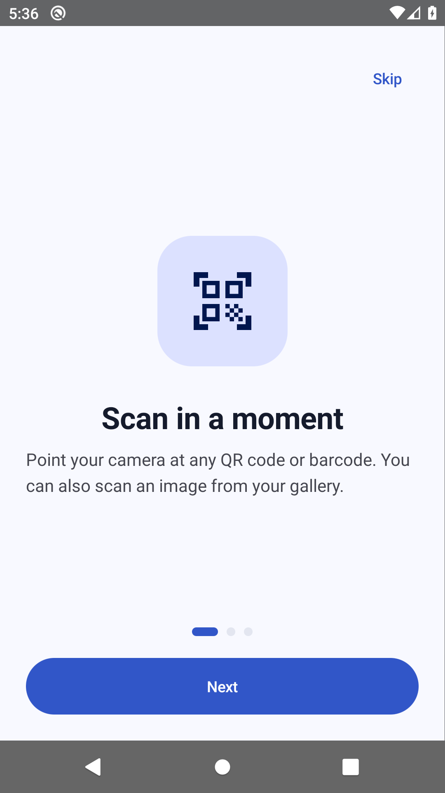
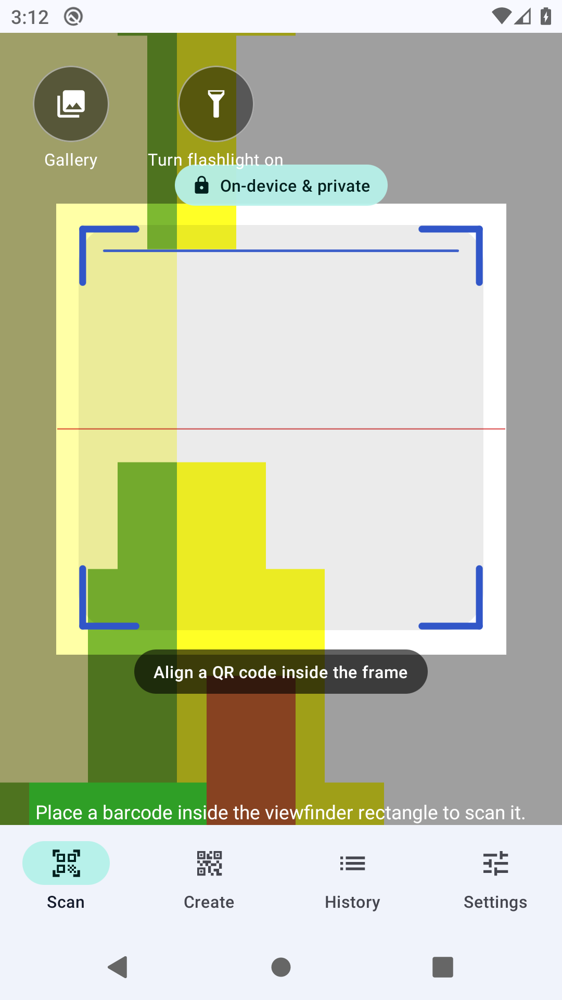
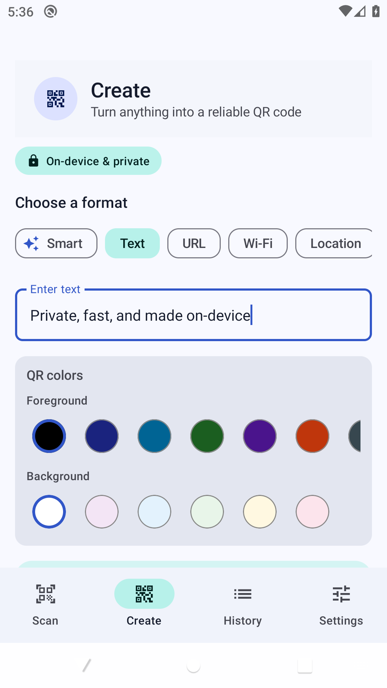
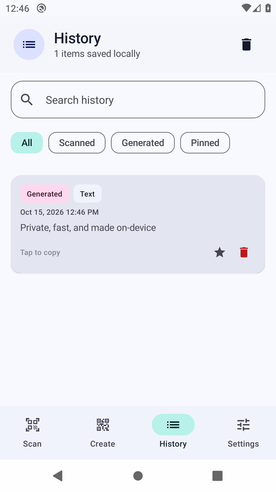
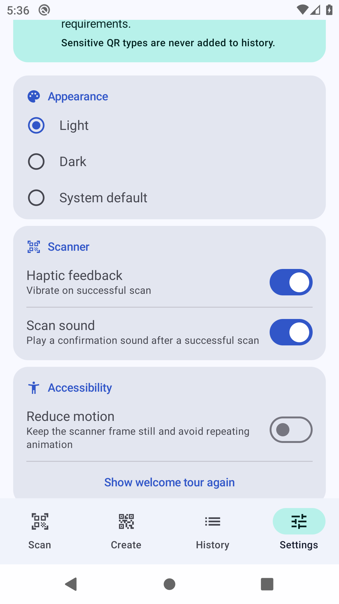
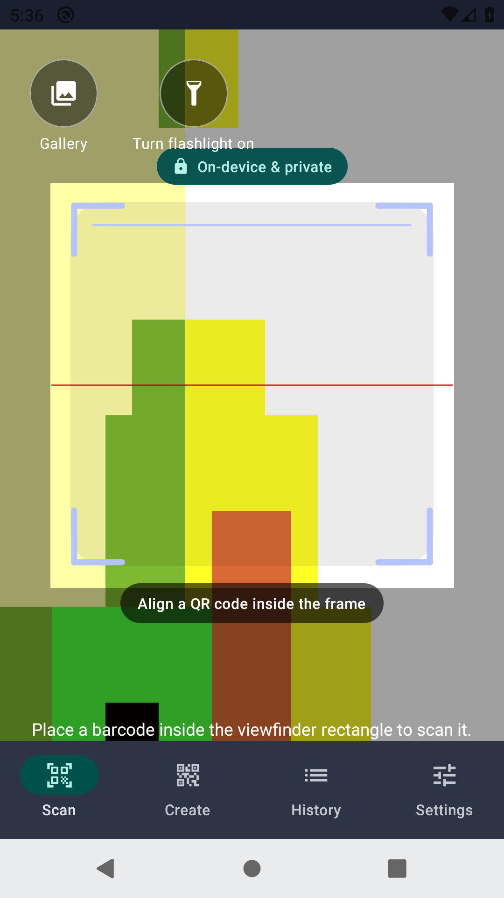
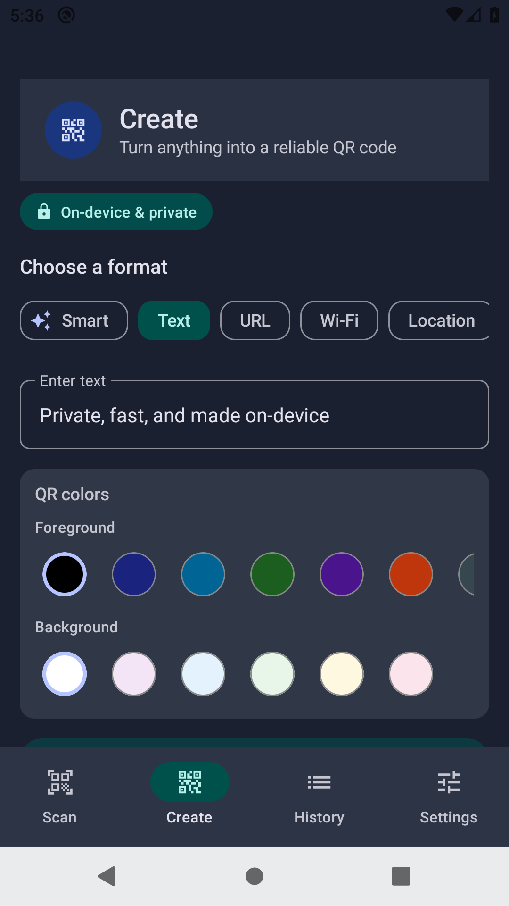
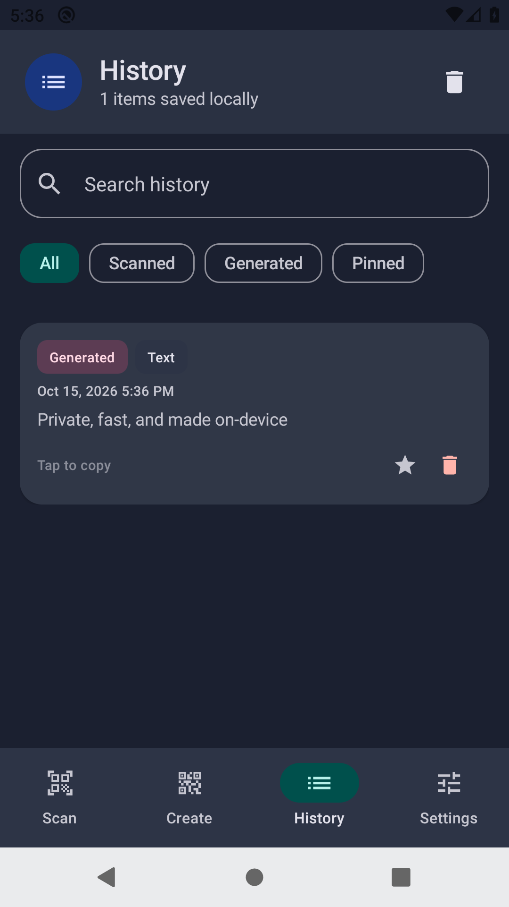
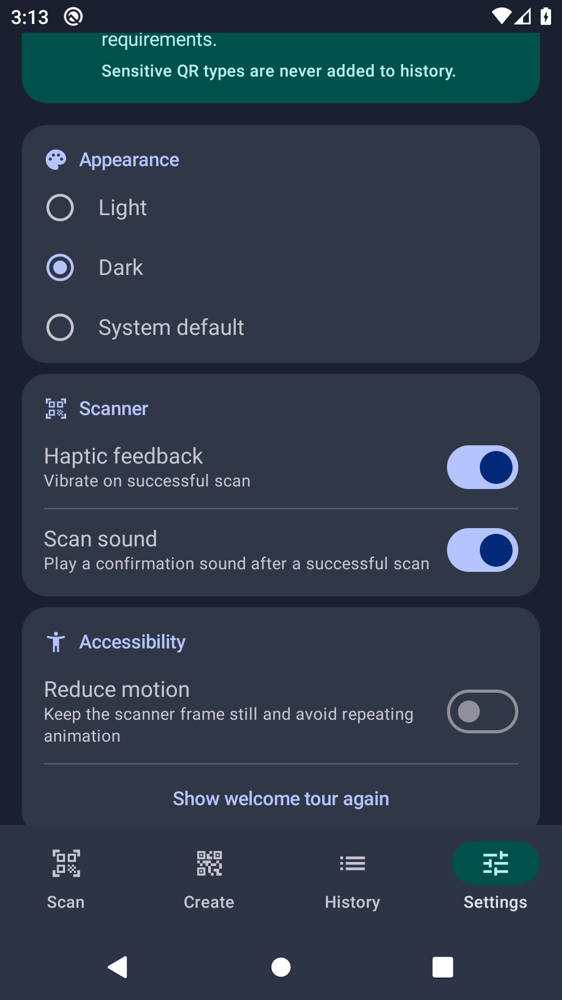

# QR Scanner & Reader [No ADs]

An ad-free Android app for scanning QR codes and barcodes, creating QR codes, and keeping optional local history. Scanning and generation run on your device, with no account required.

**Current app version:** `1.2.0` · **Minimum Android version:** Android 7.0 (API 24) · **Target SDK:** 36

## New in 1.2.0

- **Design studio:** debounced live preview, square or rounded modules, center logos, and QR-only, Wi-Fi, business, invitation, and printable-sign layouts. Save PNGs with the document picker or share them. Every studio image is decoded and compared with the original content before export is enabled. High error correction is used; overly dense designs may need shorter content.
- **Shared images:** choose Scan image from another app’s Android share sheet. Multiple detected results have separate copy and open controls, with the same history privacy policy.
- **Camera controls:** pinch to zoom and touch focus regions on supported cameras. Multiple-code mode searches each camera frame for several codes and collects distinct results for selection; gallery images are also searched for multiple codes at once.
- **Collections:** name saved entries and assign a folder, filter folders, and search names/folders as well as content. Database migration preserves existing history.
- **Home screen:** long-press the app icon for Scan/Create shortcuts. Use Add widget on a non-sensitive History entry to pin its QR (supported launchers on Android 8+). Widgets keep a snapshot until removed, even if the history entry is deleted; use only content you want visible on the home screen.

## Features

### Scan and act on results

- Scan QR codes and supported barcodes with the live camera, or choose an image from the system picker with **Gallery**.
- Toggle the flashlight and switch cameras when the device has multiple cameras. Gallery scanning also works without camera permission.
- Review the decoded content, payload type, and barcode format before choosing an action. Copy or share the result as text, then select **Scan another** to resume.
- Open HTTP/HTTPS links, view coordinates in a maps app, create a contact, compose an email or SMS, or open the phone dialer for recognized payloads.
- Add supported Wi-Fi networks through Android's confirmation screen on Android 11 and newer. WEP networks and Android 10 or earlier use Wi-Fi settings for manual setup. The parser also recognizes hidden-network data.
- Control scan sound and haptic feedback independently. Scan sound respects silent and vibrate modes.

### Create QR codes

The **Create** screen offers ten modes:

| Mode | Contents |
| --- | --- |
| Smart | Detect links, email addresses, and structured Wi-Fi, location, vCard, phone, email, or SMS data; otherwise use text. |
| Text | Plain text, including multiline and Unicode content. |
| URL | A web address; addresses without a scheme are normalized to HTTPS. |
| Wi-Fi | Network name, password, and WPA2, WPA3, WEP, or open-network security. |
| Location | Latitude and longitude. |
| Contact | A vCard with a name, phone number, and email address. |
| Email | Recipients, an optional subject, and an optional message. |
| Phone | A phone number that opens the dialer when scanned. |
| SMS | A phone number and an optional message. |
| Contact card | An extended vCard with a website and notes; Wi-Fi details and location text are included in its notes field. |

- Choose from **seven foreground** and **six background** color presets.
- Inline validation checks the fields for the selected mode. The **QR readiness** card shows input status, encoded byte count, and a reliability rating.
- Generation requires a darker foreground than background and a contrast ratio of at least **4.5:1**. Payloads above **2,400 UTF-8 bytes** are rejected; error correction adjusts to payload size.
- Preview the generated **512 × 512 PNG**, then **Save** it or **Share** it through Android's share sheet.
- Android 10 and newer save directly to **Downloads**. Android 7–9 use the system document picker to choose a destination.
- Form values, color choices, and the last generated result use saved state to survive activity recreation.

### Manage local history

- **Save to history** is enabled by default and can be turned off in Settings.
- Search saved content and filter by **All**, **Scanned**, **Generated**, or **Pinned**.
- Pin entries to keep them at the top, with newer entries first within each group.
- Each card shows its source, payload type, timestamp, content preview, and an action when supported. Tap a card to copy its contents.
- Delete an individual entry or clear the entire history, with confirmation before deletion.
- Consecutive duplicates with the same content, barcode format, and source are skipped.
- Recognized Wi-Fi, contact/vCard, email, phone, and SMS payloads are excluded from history, even when saving is enabled.

## Current interface

The app uses Jetpack Compose and Material 3, with rounded cards, large screen headings, blue accents, and mint selection and privacy indicators. Light mode uses pale backgrounds; dark mode uses navy and slate surfaces. **Light**, **Dark**, and **System default** are available in Settings, with System default selected initially.

| Screen | What you see |
| --- | --- |
| Scan | A live camera preview, framed scanning area, alignment hint, on-device privacy badge, and gallery/flashlight controls. Camera switching appears when multiple cameras are available. Results pause scanning for review. |
| Create | A heading and privacy badge, horizontally scrolling format chips, fields for the selected format, color swatches, a readiness card, and generation/preview/save/share controls below. Smart is the initial mode. |
| History | A saved-item count, search field, filter chips, and cards with type badges, timestamps, pin and delete controls. Empty and no-match states explain what to do next. |
| Settings | A privacy overview and grouped cards for appearance, scanner feedback, accessibility, history saving, and app/developer information. |

Phones use a bottom navigation bar with **Scan**, **Create**, **History**, and **Settings**. At widths of **700 dp or more**, navigation moves to a side rail. Forms scroll, and action rows adapt to narrow layouts. **Reduce motion** keeps the scanner frame still. A three-page welcome tour introduces scanning, creation, and privacy; it can be skipped or replayed from Settings.

## Screenshots

The checked-in gallery shows version 1.1.0 captured on an API 29 emulator; it does not yet show the new 1.2.0 studio, collections, or multiple-code controls. The scanner's colored background is the emulator's synthetic camera feed; a physical device shows its live camera. The Create screenshots show Text mode selected, and the History screenshots use sample content.

### Welcome

<p align="center">
  
</p>

### Light Theme

| Scanner | Create | History | Settings |
| :---: | :---: | :---: | :---: |
|  |  |  |  |

### Dark Theme

| Scanner | Create | History | Settings |
| :---: | :---: | :---: | :---: |
|  |  |  |  |

## Privacy and permissions

Scanning, image decoding, QR generation, history, and preferences are handled locally. The app has no ads, trackers, or account requirements, and its manifest requests no internet permission. Opening links or handing content to another app uses that app's services.

| Permission | Purpose |
| --- | --- |
| `android.permission.CAMERA` | Live camera scanning; requested at runtime. |
| `android.permission.VIBRATE` | Optional haptic feedback after a successful scan. |

No broad storage permission is required. Gallery images are decoded locally without being copied into app storage. App backup is disabled, and history/preferences are excluded from cloud backup and device transfer. History filtering excludes recognized sensitive payload types; plain text and URLs can still contain information you may prefer not to save.

See the [privacy policy](PRIVACY_POLICY.md) and [security reporting instructions](SECURITY.md).

## Tech stack

| Area | Implementation |
| --- | --- |
| Language and UI | Kotlin 2.2.21, Jetpack Compose, Material 3 |
| Navigation and state | Navigation Compose, ViewModel, Kotlin coroutines and Flow |
| Scanning and generation | ZXing core 3.5.3 and ZXing Android Embedded 4.3.0 |
| Local storage | Room 2.8.5 for history; Preferences DataStore for settings |
| Build tools | Android Gradle Plugin 8.10.1, Gradle wrapper 8.11.1, JDK 17 |
| Android support | Minimum API 24; compile and target API 36 |

## Build from source

### Prerequisites

- Android Studio with Android Gradle Plugin 8.10 support.
- JDK 17, matching CI and the project's Java/Kotlin target.
- Android SDK Platform 36 and the build tools requested by Gradle.

### Setup and installation

1. Clone the repository:

   ```bash
   git clone https://github.com/Aaravkhanal/qr-app.git
   cd qr-app
   ```

2. Open the project folder in Android Studio and install SDK Platform 36 through SDK Manager.
3. Select JDK 17 as the Gradle JDK. For command-line builds, point `JAVA_HOME` to JDK 17.
4. Configure the SDK path through Android Studio's untracked `local.properties` file or set `ANDROID_HOME`. Keep machine-specific paths out of version control.
5. Sync Gradle, then build and install on a connected device or emulator:

   ```bash
   ./gradlew assembleDebug
   ./gradlew installDebug
   ```

The debug APK is written to `app/build/outputs/apk/debug/app-debug.apk`. On Windows, use `gradlew.bat` in place of `./gradlew`.

### Checks and automated tests

Run formatting, unit tests, lint, and builds with:

```bash
bash scripts/check-formatting.sh
./gradlew testDebugUnitTest lintDebug assembleDebug assembleRelease bundleRelease
```

Unit tests cover payload parsing/encoding and validation, QR reliability rules, history privacy, scan-session gating, and gallery/camera policies. Instrumentation tests cover Room migrations and CRUD, settings persistence, permission states, generator validation and restoration, history controls, theme selection, onboarding, and action-intent dispatch. UI coverage includes a 280 dp layout at 200% font scale.

Run the instrumentation suite on a connected device or emulator, excluding the separate screenshot capture test:

```bash
./gradlew connectedDebugAndroidTest -Pandroid.testInstrumentationRunnerArguments.notClass=com.ritikqrscanner.app.ui.AppScreenshotTest
```

[Android CI](.github/workflows/android.yml) runs formatting, unit tests, lint, debug/unsigned-release builds, Room schema checks, and API 29 instrumentation for pushes and pull requests to `master`. The manually triggered [Android Device Matrix](.github/workflows/device-matrix.yml) runs instrumentation on APIs **24, 28, 29, 30, 33, and 36**.

### Refresh the screenshot gallery

Run the manually triggered [Current App Screenshots](.github/workflows/screenshots.yml) workflow. It runs `AppScreenshotTest` on an API 29 emulator and uploads the nine captures as the `current-app-screenshots` artifact. Download those images and replace the matching files in `screenshots/` to update this README's gallery.

To capture on a local device or emulator:

```bash
./gradlew connectedDebugAndroidTest -Pandroid.testInstrumentationRunnerArguments.class=com.ritikqrscanner.app.ui.AppScreenshotTest
adb pull /sdcard/Download/app-screenshots/. screenshots/
```

The screenshot test changes theme/onboarding settings and adds sample history. Use a test device or emulator with synthetic data.

### Release signing

Release APKs and bundles are unsigned by default. To sign them, add an untracked `keystore.properties` file in the project root:

```properties
storeFile=/absolute/path/to/release.keystore
storePassword=your-store-password
keyAlias=your-key-alias
keyPassword=your-key-password
```

Then run:

```bash
./gradlew assembleRelease bundleRelease
```

The keystore and `keystore.properties` are ignored by Git. Supply signing material through encrypted secrets when publishing from CI.

Before publishing, run the device matrix and check a physical device in bright and low light: camera permission recovery, flashlight and camera switching, gallery scanning, large fonts, both themes, save/share destinations, and installation of the signed build. Use synthetic content in store screenshots.

## Developer

- **Developer:** Aarav Khanal
- **Contact:** [khanalaarav2063@gmail.com](mailto:khanalaarav2063@gmail.com)
- **GitHub:** [Aaravkhanal](https://github.com/Aaravkhanal)

## License

Distributed under the [MIT License](LICENSE). See the license file for its copyright notice and terms.
