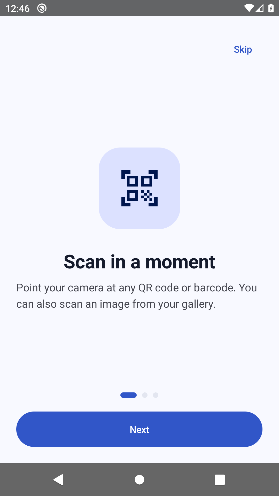
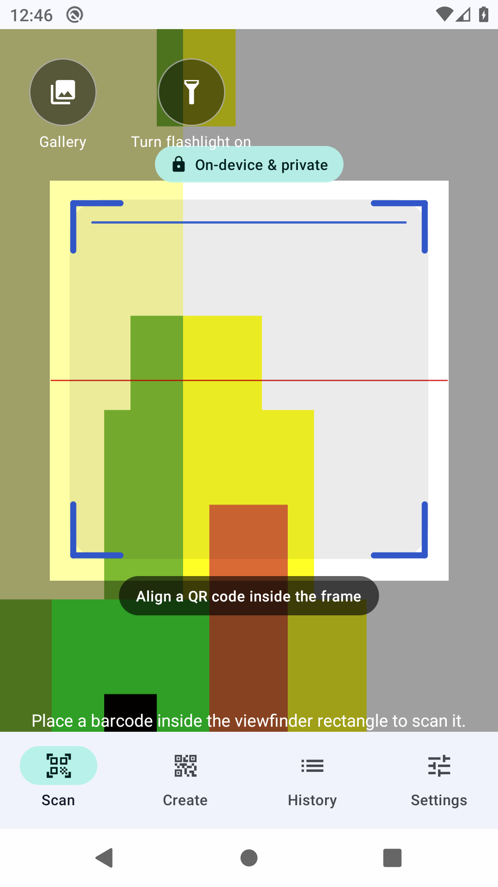
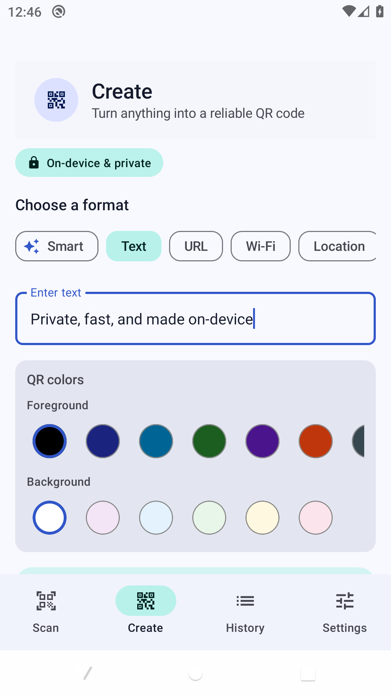
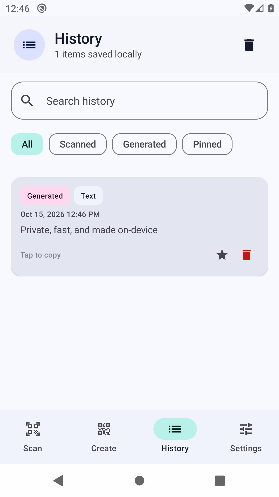
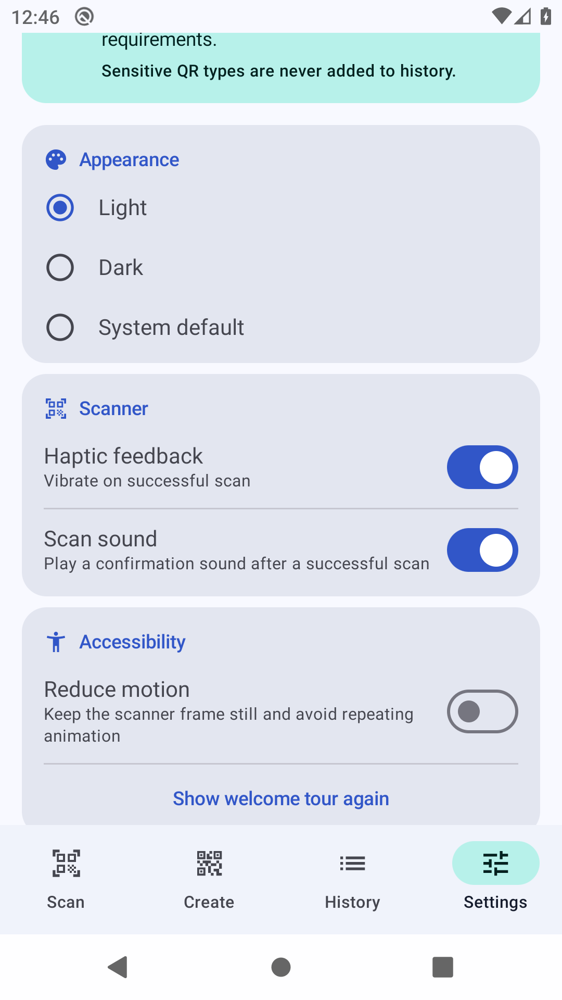
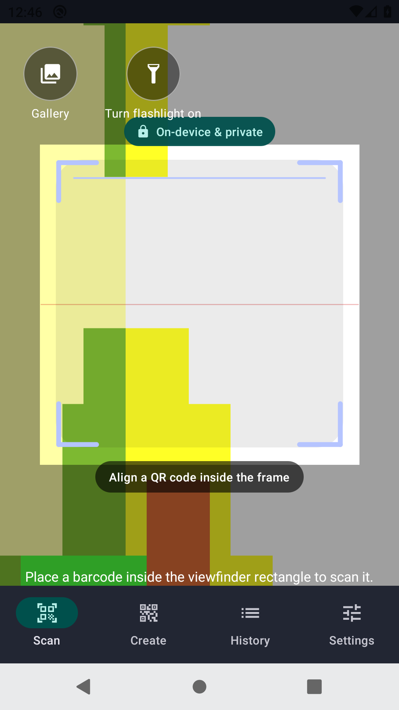
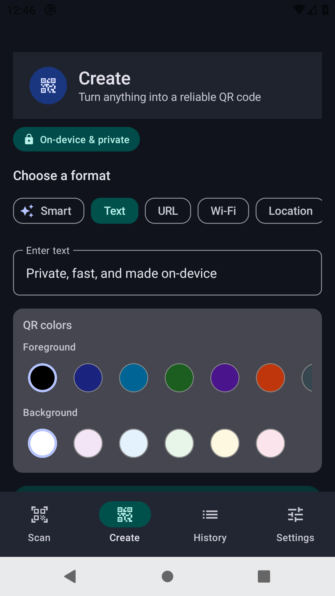
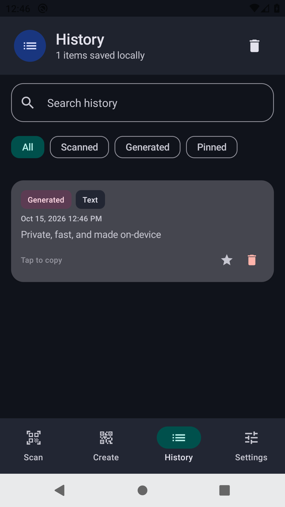
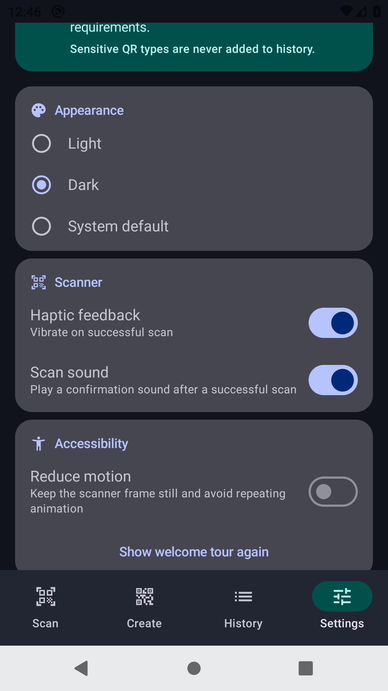

# QR Scanner & Reader [No ADs]

A fast, modern, and completely ad-free QR Scanner and Barcode Reader built natively for Android using Jetpack Compose. Designed with a minimal UI and smooth user experience, it features dynamic light and dark modes, system-confirmed Wi-Fi setup, and comprehensive history management.

## 🌟 Features
- **Lightning Fast Scanning**: Instantly decode standard QR codes, barcodes, and URLs.
- **QR Code Generator**: Create custom QR codes for Text, URLs, Wi-Fi, Locations, Contacts (vCard), Email, Phone, SMS, and extended contact cards.
- **Download & Share**: Save generated QR codes directly to your device's Downloads folder for easy sharing.
- **Modern UI/UX**: Clean, minimalist design using Jetpack Compose with beautiful dynamic Light and Dark mode themes.
- **Smart Actions**: 
  - Open Android's confirmation flow for supported Wi-Fi networks, or guide the user to Wi-Fi settings when manual setup is required.
  - Open URLs directly in the browser.
  - Smart copy-to-clipboard functionality.
- **Upload from Gallery**: Scan QR codes from images saved on your device.
- **Torch Control**: Easily toggle the camera flashlight for scanning in low-light environments.
- **History Management**: Optionally save non-sensitive scans and generated codes. Consecutive duplicates are skipped, and sensitive Wi-Fi, contact, email, phone, and SMS payloads are excluded.
- **No Ads, No Trackers**: 100% privacy-focused.
- **Fully Offline**: Does not require an internet connection to scan and decode.
- **Friendly First Run**: A concise welcome tour explains scanning, creation, and the app's privacy model.
- **Accessible Motion**: Scanner animation can be disabled while keeping the full scanning experience.

## 📸 Screenshots

These are current, automated captures from the real app running on the API 29 CI emulator. The
scanner preview uses the emulator's synthetic camera feed; a physical device shows the live camera.

### Welcome

<p align="center">
  
</p>

### Light Theme

| Scanner | Create | History | Settings |
| :---: | :---: | :---: | :---: |
|  |  |  |  |

### Dark Theme

| Scanner | Create | History | Settings |
| :---: | :---: | :---: | :---: |
|  |  |  |  |

## 💻 Tech Stack
- **Language**: Kotlin
- **UI Framework**: Jetpack Compose & Material Design 3
- **Database**: Room (SQLite) & Jetpack DataStore (Preferences)
- **Architecture**: MVVM, Compose Navigation
- **QR Core Engine**: ZXing (Zebra Crossing)

## 🛠️ How to Build from Source
Anyone can clone and build this application locally using Android Studio.

### Prerequisites
- **Android Studio** with Android Gradle Plugin 8.10 support
- **JDK 17** (the version used by CI and required for reproducible builds)
- **Android SDK Platform 36** and the latest available SDK Build Tools

### Build Instructions
1. **Clone the repository**:
   ```bash
   git clone https://github.com/Aaravkhanal/qr-app.git
   cd qr-app
   ```
2. **Open the project**:
   Open Android Studio -> `File` -> `Open...` and select the project directory.
3. **Configure the Android SDK**:
   Install Android SDK Platform 36 through Android Studio's SDK Manager. Android Studio normally creates a local, untracked `local.properties` file containing your SDK path. For command-line builds, either create that file locally or set `ANDROID_HOME`; never commit machine-specific SDK paths.
4. **Use JDK 17**:
   Select JDK 17 as the Gradle JDK in Android Studio. For command-line builds, make sure `JAVA_HOME` points to a JDK 17 installation.
5. **Sync Gradle**:
   Allow Android Studio to download dependencies and sync the Gradle files.
6. **Build and verify**:
   ```bash
   ./gradlew testDebugUnitTest lintDebug assembleDebug assembleRelease

   # Produces an unsigned bundle unless release signing is configured below.
   ./gradlew bundleRelease
   ```
7. **Install on Device**:
   ```bash
   ./gradlew installDebug
   ```

Code formatting follows the repository `.editorconfig`. Android Lint is configured in
`app/lint.xml`; run `./gradlew lintDebug` before submitting changes. CI runs unit tests, lint, and
debug and unsigned-release builds for every change to `master`.

### Automated Tests

Run the fast local checks with:

```bash
bash scripts/check-formatting.sh
./gradlew testDebugUnitTest lintDebug assembleDebug assembleRelease bundleRelease
```

Instrumentation tests cover Room migrations and CRUD behavior, settings persistence, permission
states, generator validation and restoration, history management, theme selection, and smart-action
intent dispatch. Run them on a connected device or emulator with:

```bash
./gradlew connectedDebugAndroidTest
```

The main CI workflow runs instrumentation tests on API 29. The manually triggered **Android Device
Matrix** workflow runs the same suite on APIs 24, 28, 29, 30, 33, and 36 with no front camera. The
emulator also provides the no-hardware-flash path. Compose tests exercise a 280 dp layout at 200%
font scale, and payload tests include long, escaped, multiline, Unicode, and international values.
The **Current App Screenshots** workflow launches the app on API 29 and exports the README gallery,
so documentation images can be regenerated from the current UI instead of edited by hand.

## Release readiness

Before publishing, run the manual Android Device Matrix workflow and verify one physical device in
bright light and low light. Check camera permission denial/recovery, torch availability, camera
switching, gallery scanning, large-font layouts, dark/light themes, save/share destinations, and a
signed bundle install. Store screenshots must use synthetic QR contents and must not show personal
history. Dependency updates are monitored through Dependabot; suspected vulnerabilities should be
reported using the private process in `SECURITY.md`.

### Release Signing

Local release builds are unsigned by default, so a fresh clone can run `assembleRelease` without private signing material. To create a signed release, add an untracked `keystore.properties` file in the project root:

```properties
storeFile=/absolute/path/to/release.keystore
storePassword=your-store-password
keyAlias=your-key-alias
keyPassword=your-key-password
```

The keystore and `keystore.properties` are ignored by Git. Keep both files outside version control and provide them to CI through encrypted secrets when publishing.

### Scan Feedback Policy

Scan sound and vibration are each controlled by their setting. Sound uses the notification audio
stream and only plays while the device ringer is in normal mode; silent and vibrate modes are never
overridden. The audio resource is released when the scanner leaves the screen.

## 🐛 Bug Fixes & Improvements
- **Wi-Fi Setup**: Parses open, WPA2, WPA3, WEP, and hidden networks. Android 11+ uses the system-confirmed add-network screen; WEP and older Android versions are routed to Wi-Fi settings for manual setup.
- **Dark Mode Theming**: Resolved hardcoded colors that broke UI visibility in dark mode. Complete migration to Material Theme ColorSchemes.
- **Manifest Routing**: Fixed `ClassNotFoundException` on app startup caused by namespace refactoring mismatches.
- **UI Enhancements**: Restructured the scanner screen overlay with explicit icons (Torch, Gallery, Switch Camera) matching the modern aesthetic.

## 🔐 App Permissions
To provide its functionality, the app requires the following permissions:
- `android.permission.CAMERA`: Required to scan QR codes and barcodes.
- `android.permission.VIBRATE`: Provides haptic feedback upon successful scan.

Generated QR codes are saved through MediaStore on Android 10 and newer. Android 7–9 uses the
system document picker, so the app does not need broad storage access on any supported version.

App backup is disabled. History and preferences remain local and are not intentionally included in
cloud backup. The optional history setting stores only non-sensitive payloads; Wi-Fi credentials,
contacts, email, telephone, and SMS payloads are always excluded. Gallery images are decoded locally
and are not copied into app storage.

## 👨‍💻 Developer Details
- **Developer**: Aarav Khanal
- **Contact**: [khanalaarav2063@gmail.com](mailto:khanalaarav2063@gmail.com)
- **GitHub**: [Aaravkhanal](https://github.com/Aaravkhanal)
- **Website**: [github.com/Aaravkhanal](https://github.com/Aaravkhanal/)
- **Privacy Policy**: [Read Here](https://github.com/Aaravkhanal/qr-app/blob/master/PRIVACY_POLICY.md)

## 📄 License
© 2026 Aarav Khanal. All rights reserved.
